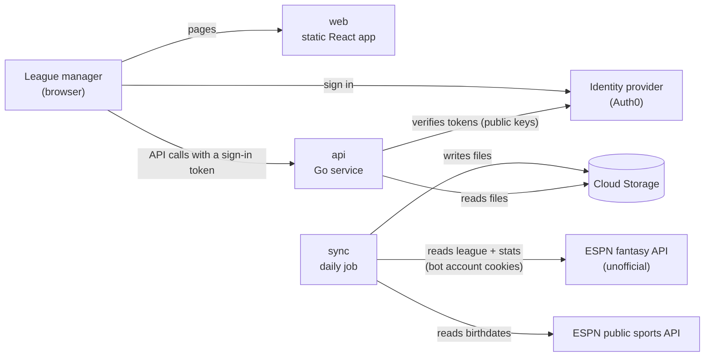
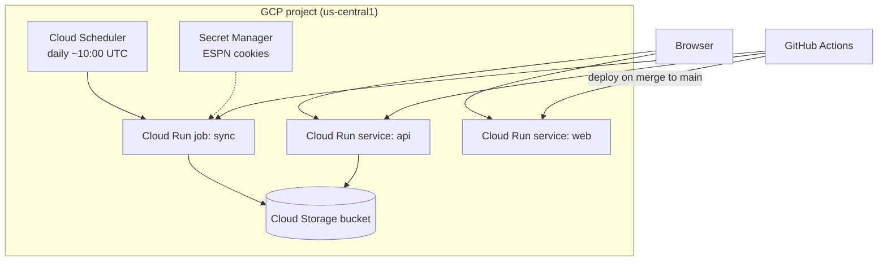
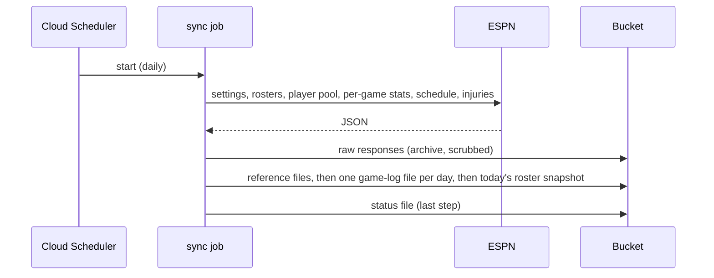

# System Architecture

> This doc explains **what the system is made of, which problems each part
> solves, and what we traded away**. Details per area: [backend.md](backend.md)
> · [frontend.md](frontend.md) · [data.md](data.md) · [espn.md](espn.md) ·
> [devops.md](devops.md) · [security.md](security.md) ·
> [testing.md](testing.md). Decisions and their alternatives:
> [decisions.md](decisions.md). ⏳ marks facts that the ESPN spike still has to
> confirm.

## 1. The system in one paragraph

hoops-dream is a small web app with three deployable pieces: a **static web
app** (React), an **API** (Go), and a **daily sync job** (Go) that pulls league
and player data from ESPN into cloud file storage. Users sign in through a
managed identity provider; the API checks their token on every call. There is no
database server: the data is a few megabytes per season, so it lives as files
and is held in memory by the API.

### Context diagram

The diagram shows who and what the system talks to. Boxes are systems; arrows
point in the direction requests are made, labeled with what travels.

**Key:** `web`, `api`, `sync` are ours and run on Cloud Run in GCP. The identity
provider is a third-party service. ESPN is read-only and unofficial. Cloud
Storage is the only persistent store.

## 2. The parts

| Part                      | What it is                                                              | Why it exists                                                                                         |
| ------------------------- | ----------------------------------------------------------------------- | ----------------------------------------------------------------------------------------------------- |
| `web`                     | A Cloud Run service that serves the built React app (static files)      | Separate deployable from the API: UI and API ship independently; the UI could move to any static host |
| `api`                     | A Cloud Run service in Go exposing a typed RPC API (Connect + protobuf) | All computation (metrics, projections) in one place; typed contract between UI and backend            |
| `sync`                    | A Cloud Run **job** in Go, started daily by Cloud Scheduler             | Pulls ESPN data on a schedule; separate from `api` so a slow or failing sync never affects users      |
| Cloud Storage bucket      | Files: raw ESPN responses, derived data, daily roster snapshots         | The $0 "database" for data that is small and refreshed in bulk                                        |
| Secret Manager            | Holds the bot ESPN account's cookies                                    | Secrets never live in code or config                                                                  |
| Identity provider (Auth0) | Hosted sign-in (Google and others), user list, roles                    | We don't write sign-in or session code                                                                |
| GitHub Actions            | CI (checks on every PR) and CD (deploy on merge)                        | No manual deploys                                                                                     |
| Terraform                 | Describes the cloud resources as code                                   | Reproducible infrastructure, owner-applied                                                            |

### Deployment diagram

Boxes inside the GCP frame are cloud resources; dashed arrows are configuration
or secret reads; solid arrows are runtime calls. GitHub Actions deploys both
services and the job.

## 3. The problems we're solving, and how

### 3.1 Getting league and stat data when ESPN has no official API

- **Problem.** Rosters, settings, and matchups exist only on ESPN. The API is
  unofficial, needs a login cookie for a private league, and can change without
  notice. Date-range stats (e.g., "last 14 days") need per-game data.
- **Solution.** A daily job logs in as a dedicated **bot ESPN account**
  (co-manager of the owner's team, no commissioner rights), fetches everything
  we need, and reshapes the responses into our own files. Per-game stats for
  every player in the league pool let us compute any window ourselves. All ESPN
  knowledge sits in one package. Raw responses are archived for rebuilding files
  later.
- **Why.** Reshaping once means the rest of the app never deals with ESPN's
  formats. One package means an ESPN change is fixed in one place. The archive
  means a parser fix or a new stat can be applied to past days without asking
  ESPN again. The bot account limits the damage if a cookie leaks to one team.
- **Tradeoffs.** We accept the unofficial-API risk. Cookies must be refreshed by
  hand when ESPN expires them (there's a runbook). If ESPN breaks, the app shows
  stale data with a warning until the adapter is fixed.
- Details: [espn.md](espn.md), [backend.md](backend.md#the-sync-pipeline).

### 3.2 Storing data at $0 without a database server

- **Problem.** Every managed database with a server costs money (Cloud SQL ≈
  $10/month). The owner ruled out Firestore. The data is tiny (≈30k player-game
  rows per season, a few MB).
- **Solution.** The sync reshapes ESPN's responses once into our own compact
  files (one game-log file per day, one roster snapshot per day, a few reference
  files) in a Cloud Storage bucket, plus a small status file saying when the
  data was last refreshed. The API loads the season into memory and computes
  everything per request. Raw responses are kept only as an archive for
  rebuilding files later; nothing reads them while serving.
- **Why.** Free, nothing to operate, and fast enough by a wide margin. Per-day
  files make every write atomic and idempotent, so a failed or repeated sync
  can't corrupt what users see.
- **Tradeoffs.** No ad-hoc SQL. When the league hub needs **user-entered data**
  (picks, trades), we will need a real database; that decision is deferred (see
  [data.md §6](data.md#6-when-we-need-a-database)). A robustness review is in
  [data.md §4](data.md#4-robustness-review).

### 3.3 Separate deployables for UI and API

- **Problem.** Serving the UI and the API from one process couples their
  releases and mixes concerns. The owner wants them separate.
- **Solution.** `web` is a static-file service; `api` is a Go service. They have
  different URLs. The browser calls the API directly with a **bearer token** in
  the `Authorization` header; the API allows cross-origin requests only from the
  web app's origin (CORS).
- **Why.** Independent deploys and rollbacks; the UI build is just files.
  Token-based auth is the standard pattern for a single-page app talking to a
  separate API, and it removes the cookie/same-site constraints that a split
  would otherwise cause.
- **Tradeoffs.** Two pipelines instead of one (both small). Tokens live in
  browser memory rather than in an HttpOnly cookie, so cross-site scripting
  protections (CSP) matter; see [security.md](security.md).

### 3.4 Sign-in and access control without writing auth code

- **Problem.** Sign-in, sessions, and user management are easy to get wrong and
  expensive to maintain. We also need an invite list now and league-wide roles
  later.
- **Solution.** A managed identity provider hosts sign-in (Google first; others
  later), keeps the user list, and issues short-lived tokens. The API validates
  tokens with the provider's public keys and enforces **a declared permission on
  every RPC** (deny by default). Roles come from token claims now and from our
  own database when the league hub needs per-league, per-team mappings.
- **Why.** Near-zero security code of our own; standard protocols (OIDC, JWT);
  invite/revoke in the provider's dashboard; multiple sign-in methods for free.
- **Tradeoffs.** A third-party dependency whose free tier could change; the
  sign-in page lives on the provider's domain unless a custom domain is set.
  Provider choice:
  [security.md §8](security.md#8-choosing-the-identity-provider).

### 3.5 Metrics that are easy to add

- **Problem.** The owner wants to add player and team metrics over time without
  touching the API contract or UI each time.
- **Solution.** A **metric registry** in the backend: each metric is a small Go
  function plus a registration (id, label, scope, format, dependencies) and a
  worked-example test. The API returns metrics as named columns and exposes a
  catalog; the UI builds table columns from the catalog.
- **Tradeoffs.** A little indirection in exchange for "new metric = one
  function". An in-app formula editor is explicitly out of scope. Details:
  [backend.md](backend.md#the-metric-registry).

### 3.6 Keeping the cost at about $0

- **Solution.** Everything scales to zero (Cloud Run, Scheduler, Storage, Secret
  Manager, GitHub Actions free minutes). Fixed-cost resources (load balancers,
  always-on instances, SQL servers) are banned in `AGENTS.md`. Budget alerts at
  $1 and $5.
- **Tradeoffs.** First request after idle takes about a second. No staging
  environment; instead, each deploy is smoke-tested on a no-traffic revision
  before it takes traffic ([devops.md](devops.md)).

### 3.7 Working safely with AI coding agents

- **Problem.** Agents can't reach ESPN from CI or sandboxes, and they run on the
  owner's laptop next to real credentials.
- **Solution.** Recorded ESPN responses (scrubbed of login material) are the
  agents' only ESPN; `make replay` rebuilds local data from them offline. Cloud
  commands are owner-only and blocked by tool deny-lists. Every change must pass
  `make check` and the owner's manual verification before it's committed.

## 4. Two flows, step by step

### Opening a page and loading data

1. The browser loads the React app from `web`.
2. The app asks the identity provider for a token (silently if the user signed
   in recently; otherwise it shows the provider's sign-in page).
3. The app calls `api` with `Authorization: Bearer <token>`.
4. `api` verifies the token, checks the RPC's required permission against the
   user's roles, computes the answer from in-memory data, and returns it with
   `data_as_of` so the UI can show freshness.

### The daily sync

The status file is written last, so "Data as of" only advances when everything
before it succeeded. Each file is written whole, so a failure mid-way leaves the
previous version of every untouched file in place; the status page shows the
error.

## 5. One rule that keeps future features cheap

**Player statistics never depend on rosters.** Stats are facts about players;
rosters are facts about teams. Keeping them separate is what makes the roster
sandbox (M8) a pure re-computation of team-level numbers, and it lets team
metrics be computed for any past day from roster snapshots.
